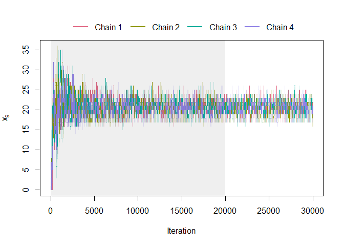

<!-- README.md is generated from README.Rmd. Please edit that file -->

# extensionSamplers

<!-- badges: start -->

<!-- badges: end -->

The package extensionSamplers was developed in conjunction with writing
the paper ‘Extended Fibre Samplers for Statistical Linear Inverse
Problems’. It implements a few different extension samplers, including
p-Markov basis samplers, hyperrectangle samplers and knapsack samplers.
It also implements a few visualisation tools.

## Installation

You can install the development version of extensionSamplers from
[GitHub](https://github.com/) with:

``` r
# install.packages("pak")
pak::pak("LinusFromm/extensionSamplers")
```

## Example

This is a basic example from the accompanying paper (4-highway with
Poisson assumptions):

``` r
library(extensionSamplers)
A = extensionSamplers::highway4$A
M = extensionSamplers::highway4$FMB
lambda = extensionSamplers::highway4$lambda
x = extensionSamplers::highway4$x
y = A%*%x
A2Idx = extensionSamplers::highway4$A2IdxLB
LB = extensionSamplers::highway4$LB

xStart <- lpSolve::lp(direction = "max",
                      objective.in = rep(1, 10),
                      const.dir = "==",
                      const.mat = A,
                      const.rhs = y,
                      all.int = TRUE)$solution

nSample = 1e+05
nBurnin = 2e+04

i = 9

set.seed(2027)
LB_samples_burnin <- extensionSamplers::sampler(A = A,
                                                y = y,
                                                B = LB,
                                                Model = "poisson",
                                                lambda = lambda,
                                                extension = "p",
                                                p = ifelse(1:10 %in% A2Idx, 0, 1),
                                                loggamma = 0,
                                                w = 2,
                                                xStart = xStart,
                                                nSample = nSample,
                                                nBurnin = nBurnin,
                                                nChains = 4,
                                                includeBurnin = TRUE)

LB_samples <- LB_samples_burnin[c((nBurnin+1):(nBurnin+nSample),
                                  (2*nBurnin+1+nSample):(2*nBurnin+2*nSample),
                                  (3*nBurnin+1+2*nSample):(3*nBurnin+3*nSample),
                                  (4*nBurnin+1+3*nSample):(4*nBurnin+4*nSample)),]
LB_samples[,12] <- rep(1:nSample, 4)
LB_samples[,13] <- 1:(4*nSample)

LB_samples_pos <- extensionSamplers::onlyPositive(LB_samples)

positive_portion_LB <- sum(complete.cases(LB_samples_pos))/(4*nSample)

nBurnin = 2e+04
nExtra = 1e+04

xRange = range(LB_samples_burnin[c(1:(nBurnin+nExtra),
                                    (nBurnin+nSample) + 1:(nBurnin+nExtra),
                                    2*(nBurnin+nSample) + 1:(nBurnin+nExtra),
                                    3*(nBurnin+nSample) + 1:(nBurnin+nExtra)),i])

extensionSamplers::traceplot(LB_samples_burnin[c(1:(nBurnin+nExtra),
                                                 (nBurnin+nSample) + 1:(nBurnin+nExtra),
                                                 2*(nBurnin+nSample) + 1:(nBurnin+nExtra),
                                                 3*(nBurnin+nSample) + 1:(nBurnin+nExtra)),], i, TRUE, 0.2, ylim = xRange)
rect(0, -100000, nBurnin, 100000, col = "#00000010", border = "#00000000")
```


